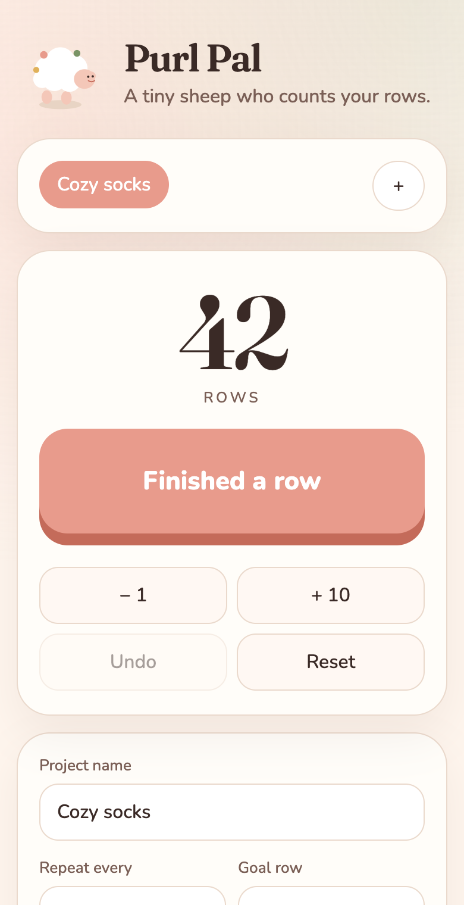
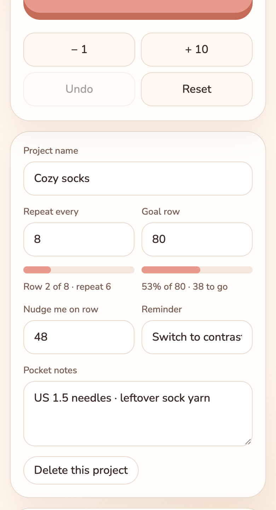
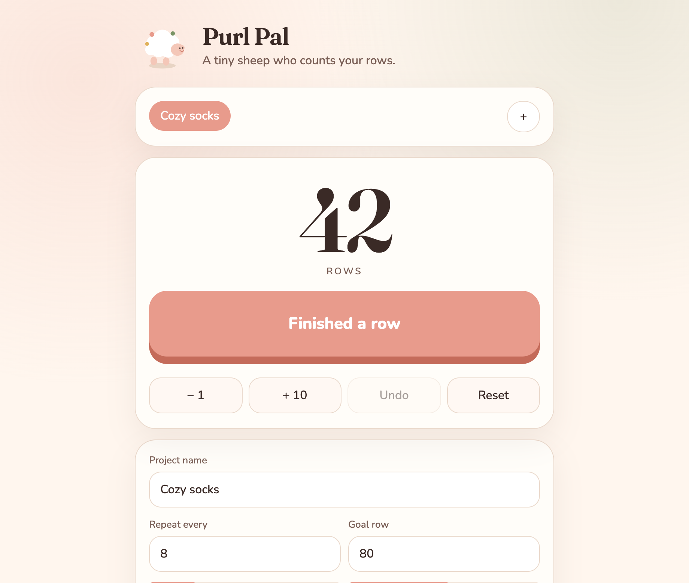

# Purl Pal

A cozy little row counter for knitting and crochet. Tap once when you finish a row. A sheep hops. Your place stays put.

**Use it:** https://lemur-cpu.github.io/purl-pal/

<p align="center">
  
</p>

## Demo walkthrough

1. **Open a project** — Purl Pal starts with “Cozy socks,” or tap **+** for a new one. Switch projects from the chips at the top.
2. **Tap when you finish a row** — the big button is the whole point. `− 1`, `+ 10`, **Undo**, and **Reset** sit underneath for corrections.
3. **Set a repeat and a goal** — “Repeat every 8” tracks where you are in the pattern; a goal row shows how far you’ve come.
4. **Leave yourself a nudge** — e.g. row 48 → “Switch to contrast yarn.” Notes stay in your pocket for needle size and leftover yarn.

<p align="center">
  
</p>

<p align="center">
  
</p>

Keyboard: `Space` or `+` adds a row. `-` subtracts. `Ctrl/Cmd+Z` undoes.

## What it does

- Counts rows with a giant, thumb-friendly button
- Tracks pattern repeats (`row 3 of 8 · repeat 2`) and cheers when a repeat lands
- Shows progress toward a goal row
- Nudges you on a chosen row — “switch to contrast yarn”
- Keeps several projects, each with its own notes
- Saves everything in this browser. Nothing is sent to a server
- Optional screen wake-lock and haptic taps
- Add to your phone’s home screen from the share menu

## Run it locally

```bash
python3 -m http.server 4173
```

Then open http://localhost:4173

## Tests

```bash
node --test tests/*.test.js
```

## License

MIT
